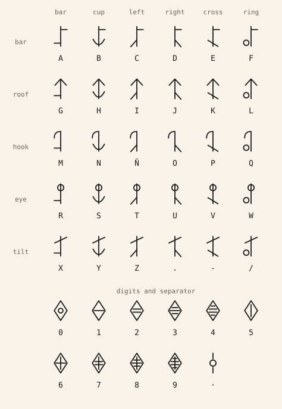

# The rune alphabet

Every rune on the site (the hero's magic circle, the sigils in Habilidades and in the side
rail, the "JM" seal, the contact form's circle) is real writing in one original alphabet.
Nothing is random: each mark spells a word you can read with the chart below.

The code is `lib/runes.ts`; the chart is drawn from it by `npx tsx scripts/runes-sheet.ts`.

## How a letter is built

Every letter is one **spine** (a vertical stroke) plus two marks:

- a **head** at the top, which says the row of the table;
- a **foot** at the bottom, which says the column.

| head ↓ / foot → | bar | cup | left | right | cross | ring |
| --------------- | --- | --- | ---- | ----- | ----- | ---- |
| **bar**         | A   | B   | C    | D     | E     | F    |
| **roof**        | G   | H   | I    | J     | K     | L    |
| **hook**        | M   | N   | Ñ    | O     | P     | Q    |
| **eye**         | R   | S   | T    | U     | V     | W    |
| **tilt**        | X   | Y   | Z    | .     | -     | /    |

The marks:

- **Heads.** _Bar_ is a short flag to the right. _Roof_ is a chevron, like an arrow tip. _Hook_ curls to the left. _Eye_ is a small circle the spine passes through. _Tilt_ is a rising slash.
- **Feet.** _Bar_ is a short flag to the left. _Cup_ is a curve under the spine. _Left_ and _right_ are a leg branching down that way. _Cross_ is a slash through the spine. _Ring_ is a small circle at the lower left.

So "J" is roof + right leg (row 2, column 4), and "O" is hook + right leg.

Ñ has its own rune, right after N, because it is a letter in Spanish.

## Digits and the separator

- **Digits** have no spine. They are a diamond with tally marks inside:
  - 0 is a diamond with a small eye;
  - 1 to 4 have one to four short bars;
  - 5 has a vertical stroke;
  - 6 to 9 have the stroke plus one to four bars.
- **The separator "·"** is the spine opening into an eye in the middle. It marks where one phrase ends and the next begins, and where a ring's end meets its start.
- **A space** between words is an empty position, with no rune.

## Writing rules

- Capitals only, since case doesn't exist. Accents are dropped (Á is written as A); Ñ keeps its own rune.
- Spaces and "_" become one gap. " · " becomes the separator. Any other character is left out.
- On a circle, the text reads **clockwise from the top**, with the tops of the runes facing outward. A separator closes the ring where the text wraps around.

## What each piece says

| Where                                                                    | What it spells                                                                                                  |
| ------------------------------------------------------------------------ | --------------------------------------------------------------------------------------------------------------- |
| Hero circle, outer ring (also the big circle behind it and the 404 page) | `JEFERSON MORILLO · EL CONTADERO · NARIÑO · 2024`: name, birthplace, region, and the year he started the degree |
| Hero circle, inner ring                                                  | `CONSTRUYO SOFTWARE` ("I build software")                                                                       |
| "JM" seal (header, footer, contact letter)                               | `JEFERSON MORILLO`                                                                                              |
| Habilidades sigils                                                       | The tool's name (`Next.js`, `Jetpack Compose`…)                                                                 |
| Category sigils in Habilidades and the side-rail sigils                  | The category or section name, in the language of the page                                                       |
| Shelf books and project covers                                           | The book or project title                                                                                       |
| Contact form circle                                                      | The four field runes spell `HOLA`; the centre rune, `J`, signs the letter once every field is valid             |

The runes stay in Spanish on the English site, like an inscription. The decoded reading
gives English visitors a translation.

### Anatomy of a sigil

- **Outer band:** the name, repeated with separators when it is short so the ring is always full (`VITE · VITE · VITE ·`).
- **Centre:** the name's first letter, large.
- **Polygon:** it has 3 + (number of runes in the name, mod 4) corners, so the shape also comes from the name. Every other corner has a small node.

## The hidden reading

Rest the pointer on the hero portrait for two seconds, or press and hold it on a phone. A
small slip then decodes both rings ("Las runas dicen" / "The runes read"). On the English
site it adds the translation of "Construyo software". The rings warm to vermilion and the
slip fades away after a few seconds. With reduced motion it is a plain tooltip: it
appears without movement and stays while the pointer is there. The code is
`components/fx/RuneReading.tsx`.

## Originality

This is an original featural alphabet: a spine, a head for the row, a foot for the column.
It is not based on any real script (Germanic runes, Ogham, Tengwar…) or on the magic
writing of any anime or game. A few single strokes, like a vertical line or an arrow tip,
appear in many scripts. No rune here is used alone, though: every letter combines a head
and a foot, and the meaning comes from the table above.

## Before this alphabet

Until October 2026 the runes were random. Each one picked 2–4 strokes from a small set
(stems, diagonals, bars, curves, a small circle), using a deterministic generator seeded
with a number. Each sigil was seeded with a hidden name ("Escuela de la vitrina", "Del
campo al valle"…). The shapes looked consistent but spelled nothing, and some came out
looking like real Germanic runes by accident.
